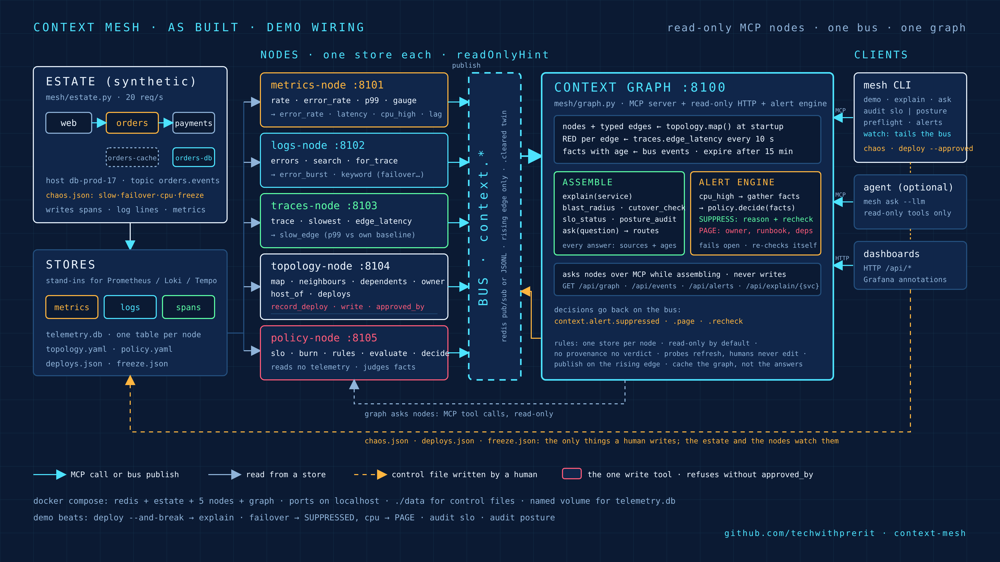

# context-mesh

**Logs, metrics and traces that explain themselves.** A working proof of concept of a
*context-driven telemetry mesh*: one MCP node per signal store, one bus of context events, and one
graph that answers *"what's wrong, why, and how do you know?"*, with every answer citing its
sources and their age.

This is the demo from the talk **"Logs, Metrics, Traces… Assemble! Building a Context-Driven Mesh"**.
It runs on a laptop in about a minute, needs no cloud account and no LLM, and every value it produces is synthetic.

> **Saw the talk?** Jump to the [Quick start](#quick-start-5-minutes) and run the exact demo from the stage, or
> open the repo in your coding agent and say *"Read AGENTS.md and run this as a POC"*.



---

## Contents

- [The talk in one minute](#the-talk-in-one-minute)
- [Why](#why)
- [What you'll see](#what-youll-see)
- [Quick start (5 minutes)](#quick-start-5-minutes)
- [Walk through the demo](#walk-through-the-demo)
- [How it works](#how-it-works)
- [CLI reference](#cli-reference)
- [Running without Docker](#running-without-docker)
- [Troubleshooting](#troubleshooting)
- [Pointing it at real backends](#pointing-it-at-real-backends)
- [Use it with a coding agent](#use-it-with-a-coding-agent)
- [The Claude skill](#the-claude-skill)
- [Repository layout](#repository-layout)
- [License](#license)

---

## The talk in one minute

Today every signal lives in its own tool, and a human joins them by eye. The talk argues for moving that
join into the system, with four parts:

1. **One thin MCP node per signal store** (metrics, logs, traces, topology, policy). Each node is read-only
   and has two or three tools phrased as questions.
2. **A bus of context events.** A node publishes a small fact when something crosses a line, and a
   `.cleared` twin when it stops.
3. **One context graph**, built from topology. Its edges carry live RED, and it holds facts that have an
   age and expire. Humans, agents and alert rules all ask this one graph.
4. **No provenance, no verdict.** Every answer cites its sources and how old they are.

The demo proves three claims, one per beat:

| Beat | Claim |
|---|---|
| 1 | Correlation across layers happens **before anyone asks**. Four independent nodes publish facts, and the graph joins them into one story with a cause, evidence and sources. |
| 2 | An alert can fire **on context, not on a threshold**. The same CPU number is suppressed once (with a reason and a re-check) and paged once (with a runbook and the dependents). |
| 3 | The **same graph** answers SLO burn-rate and security-posture questions. Nothing new gets built; the graph only joins. |

## Why

At 3 a.m. the metrics say *p99 is up*, the logs say *upstream timeout*, the traces say *orders → payments
is slow*, and the deploy log says *someone shipped payments 6 seconds ago*. Four tools, four tabs,
and **a human doing the join**.

A context mesh moves that join into the system:

| Instead of… | the mesh does… |
|---|---|
| dashboards you have to correlate by eye | nodes publish **facts** to a bus the moment something crosses a line |
| a threshold that pages | a threshold becomes a **question** to a policy ("is this expected?") before it becomes a page |
| answers you have to trust | **every answer carries its sources and their age.** No provenance, no verdict. |
| an AI agent with write access to prod | read-only tools everywhere; the one write tool **refuses without a human approver** |

## What you'll see

A payments deploy goes bad. Before anyone asks, four independent nodes have each published one fact.
Then one question gets one answer:

```
$ mesh explain orders
cause   deploy v2.3.1 of payments 6s ago; symptoms started 2 s after it  (confidence high)
action  roll back payments to the previous version (write: needs a human approver)

hot edges
  orders -> payments   6.67 req/s  err 1.0%  p99 2031 ms  slow p99 1737 ms vs baseline 66 ms

evidence (oldest first)
  deploy v2.3.1 of payments by prerit                          [topology-node, 6s ago]
  orders -> payments p99 1737 ms (baseline 66 ms)              [traces-node, 3s ago]
  7 error lines/min: "charge failed: upstream timeout ..."     [logs-node, 1s ago]
  p99 1979 ms on payments                                      [metrics-node, 1s ago]

one request, three signals
  metric   error_rate 1.0% over 800 req / 5m                   [metrics-node]
  trace    9e6f973dee5642e5 2355 ms
           web:GET /checkout ✗ → orders:POST /orders ✗ → payments:POST /charge ✗
  log      payments ERROR charge failed: upstream timeout ... trace=9e6f973dee5642e5
  log      orders ERROR POST /orders 502: payments unavailable trace=9e6f973dee5642e5

sources  topology-node 6s ago · traces-node 0s ago · logs-node 1s ago · metrics-node 0s ago
```

Then the **same CPU threshold is crossed twice**. Once it's suppressed (a failover is in progress, so
the high CPU is expected; re-check in 120 s), and once it pages (no explanation, with runbook and
dependents). Finally the **same graph** runs an SLO burn-rate audit and a security-posture audit.

## Quick start (5 minutes)

**You need:** Docker (Desktop, or Engine with Compose v2), Python **3.11+**, ~2 GB free RAM. macOS and Linux are tested.

```bash
git clone https://github.com/techwithprerit/context-mesh-demo.git && cd context-mesh-demo

# 1. Start the mesh: redis + a synthetic estate + 5 MCP nodes + the graph (all bound to localhost)
make up

# 2. Install the `mesh` CLI on the host (a venv, because Homebrew/system Python refuses global pip)
python3 -m venv .venv && source .venv/bin/activate
pip install -e .
export BUS_URL=redis://localhost:6379/0

# 3. Clean slate, let the estate build a healthy baseline, then the go/no-go check
make reset && sleep 30
mesh preflight
```

`mesh preflight` should end with six `pass` lines and:

```
  GO: walk on
```

On macOS, `make stage` runs steps 1 and 3 in one go: it starts Docker Desktop if needed, then brings the
stack up, resets, waits and runs preflight. On Linux, start the Docker daemon yourself and use the steps above.

When you're done: `make down` (keeps `./data`) or `make clean` (removes everything).

## Walk through the demo

Open **two terminals** in the repo, both with the venv active and `BUS_URL` exported.

```bash
# Terminal B: the bus, live. Leave it running.
mesh watch --all

# Terminal A: the guided run of show. Press Enter at each step.
mesh demo --approved-by "$USER"
```

The director runs the real commands and waits for the right events on the bus between steps, so you
can't type into a half-ready estate. To watch the whole thing unattended (~2.5 min), run `mesh rehearse`.

| Beat | Commands it runs | What to look for |
|---|---|---|
| **1 · Correlation across layers** | `explain orders` → `deploy payments v2.3.1` (refused, then approved, `--and-break`) → `explain orders` | Terminal B: `deploy`, `error_burst`, `slow_edge` and `latency` from four different nodes. Then a cause, evidence and one request joined across metric, trace and logs by trace id. |
| **2 · Alerts that fire on context** | `chaos failover db-prod-17` → (wait for clear) → `chaos cpu db-prod-17` | Same threshold twice: **SUPPRESSED** (reason + recheck), then **PAGE** (dependents + runbook). Both explain what they looked for. |
| **3 · SLOs and posture, same graph** | `audit slo` → `audit posture` | payments **BURNING**, orders/web **ELEVATED**, then five posture findings, one of them annotated with live traffic from the graph. |

### Or: the whole demo in one terminal

`mesh tui` puts everything on one full-screen window, for Ghostty, iTerm2, WezTerm or any truecolor
terminal. It runs the same director as `mesh demo`, so the beats, commands and waits are identical. Around
it you get live **vitals** (req/s, error rate and p99 per service with sparklines, every call edge from the
traces, db-prod-17's CPU and replica lag), the **bus** (PAGE and SUPPRESSED flash the screen and ring the
bell), node health, the run of show ticking off, and optional **speaker notes with pace**.

```bash
pip install -e '.[tui]'                  # adds textual
mesh tui --approved-by "$USER"           # or: make tui      (add --extended for the cutover + freeze beat)
```

| Key | Does |
|---|---|
| `p` / `r` | preflight / `make reset`, wait 30 s, preflight. The top bar shows GO or NO-GO |
| `d` | the demo, one key per beat: `Enter` or `space` runs the step shown in the amber bar |
| `R` | rehearse: the whole flow unattended (`a` switches a running demo to auto) |
| `esc` | abort the demo at its next pause (then `r`) |
| `:` | run any `mesh` command in place, e.g. `: explain payments`, `: chaos cpu db-prod-17` |
| `ctrl+p` | command palette: every read command, chaos knob and action, fuzzy-matched |
| `f` | filter the bus: all → alerts → topology → metrics → logs → traces |
| `n` | speaker notes for the current step, with target time and ahead/behind. They're on screen, so turn them off before mirroring |
| `e` `u` `o` `s` | explain orders · audit slo · audit posture · status |
| `z` | focus: the director alone, full width (for big fonts on a projector) |
| `v` / `b` | hide the vitals panel / the whole right column |
| `w` | save the session (director output + every bus event) to `data/tui-session-*.log` |
| `?` / `c` / `q` | help / clear / quit |

In Ghostty, go full screen (`cmd+enter`) and size the font with `cmd+=` / `cmd+-`. The layout follows the width:
150+ columns shows all three columns, 110–149 drops the right column, and under 110 only the director shows.

Want to poke around yourself?

```bash
mesh ask "is orders safe to cut over right now?"
mesh ask "who depends on orders-db"
mesh chaos slow payments           # and: cpu, failover, freeze on|off, reset
mesh events -n 10
curl -s localhost:8100/api/explain/orders | jq
```

## How it works

```
                 ┌──────────── bus (redis pub/sub or a JSONL file) ────────────┐
                 │  context.metrics.*  context.logs.*  context.traces.*  ...   │
                 └───▲──────────▲──────────▲──────────▲──────────▲────────┬────┘
                     │          │          │          │          │        │ subscribes
   ┌──────────┐ ┌────┴────┐┌────┴────┐┌────┴─────┐┌───┴──────┐┌──┴──────┐┌▼──────────────┐
   │  estate  │ │ metrics ││  logs   ││  traces  ││ topology ││ policy  ││ context-graph │
   │(synthetic│ │  node   ││  node   ││   node   ││   node   ││  node   ││  MCP + HTTP   │
   │ services)│ │ :8101   ││ :8102   ││  :8103   ││  :8104   ││ :8105   ││   :8100       │
   └──┬───────┘ └────┬────┘└────┬────┘└────┬─────┘└────┬─────┘└────┬────┘└───────▲───────┘
      │ writes       │ reads    │ reads    │ reads     │ reads     │ reads        │ asks (MCP)
      ▼              ▼          ▼          ▼           ▼           ▼              │
   telemetry.db   metrics     logs       spans    topology.yaml policy.yaml   mesh CLI / agent
                  (one table each: "one signal store, never two")
```

- **The estate** ([`mesh/estate.py`](mesh/estate.py)) simulates web → orders → payments → orders-db,
  with a cache and a Kafka topic, and writes metrics, logs and spans to SQLite. Chaos knobs make it misbehave.
- **Nodes** ([`mesh/nodes/`](mesh/nodes/)) are MCP servers (`mcp` SDK 2.x, streamable HTTP). Each reads
  **one** store, exposes 2 or 3 question-shaped tools, is read-only by default (`readOnlyHint`), and publishes
  a **context event** on the rising edge of a threshold, plus a `.cleared` twin on the falling edge. Nodes never call each other.
- **The bus** ([`mesh/bus.py`](mesh/bus.py)) is redis pub/sub in Docker and an append-only JSONL file in local mode.
- **The graph** ([`mesh/graph.py`](mesh/graph.py)) builds itself from the topology node, annotates edges with
  RED (rate, errors, duration) from the traces node, attaches facts from the bus (facts expire after 15 min),
  and exposes assembly tools: `explain`, `blast_radius`, `slo_status`, `posture_audit`, `cutover_check`, `ask`.
- **The alert engine** lives in the graph. A threshold crossing goes to the policy node's `decide` as a
  question first. Suppressions carry a reason and a re-check, and pages carry context. If it can't decide, it **fails open** and pages.
- **Policy is prose** ([`mesh/policy.yaml`](mesh/policy.yaml)): SLOs, posture rules, and alert rules such as
  `suppress_if: "replica catch-up in progress on the same host after a failover in the last 15 min"`.
- **The one write tool** (`topology.record_deploy`) refuses without `approved_by`. The posture audit finds it by reading the mesh's own tool annotations.

### Rules the code enforces

1. **One node reads one store.** (`telemetry.py` has three tables; each node touches one.)
2. **Read-only by default.** A write is a proposal until a human approves it. (`record_deploy`)
3. **No provenance, no verdict.** Every tool result carries `source` and `ts`, and the graph renders their ages.
4. **Probes refresh the graph; humans never edit it.** Facts expire.
5. **Publish on the edge.** Rising-edge events with `.cleared` twins, never a stream of samples.
6. **A threshold is a question before it's a page.**
7. **Cache the graph, not the answers.** `ask` is deterministic; a model (`--llm`) is only a side door over the same read-only tools.

## CLI reference

| Command | What it does |
|---|---|
| `mesh status` | every node, its port and its tools (write tools flagged) |
| `mesh preflight` | six go/no-go checks: nodes, estate, graph, bus round-trip, baseline, clean state. Exits non-zero on NO-GO |
| `mesh demo [--approved-by NAME] [--auto] [--extended]` | the guided run of show, one Enter per beat |
| `mesh rehearse` | `demo --auto --extended`: the whole flow unattended, ~2.5 min |
| `mesh tui [--approved-by NAME] [--extended]` | the same run of show as a full-screen TUI: director, bus, nodes, beats (`pip install -e '.[tui]'`) |
| `mesh explain <service>` | cause, action, hot edges, evidence timeline, one request as metric + trace + logs, sources with ages |
| `mesh watch [--all]` | tail the bus: threshold events in, SUPPRESSED / PAGE decisions out |
| `mesh alerts` | the decisions the alert engine has taken so far |
| `mesh events [-n N]` | recent bus events as a timeline |
| `mesh audit slo` | multi-window burn rate per SLO, and the edge burning the budget |
| `mesh audit posture` | policy rules over topology, deploys, freeze and the mesh's own tools |
| `mesh ask "<question>"` | plain words → cutover check / explain / blast radius / SLO / posture |
| `mesh ask --llm "<question>"` | optional: a Claude model drives the same read-only tools (`pip install -e '.[llm]'`, `ANTHROPIC_API_KEY`) |
| `mesh deploy <svc> <ver> --approved-by NAME [--and-break]` | the one approved write; `--and-break` makes the new version slow and flaky |
| `mesh chaos slow\|cpu\|failover\|freeze on\|off\|reset …` | the knobs on the estate |

| Make target | What it does |
|---|---|
| `make up` / `make down` | start / stop the Docker stack |
| `make stage` | start Docker if needed, bring the stack up, reset, wait, preflight |
| `make reset` | clean slate: chaos, freeze, deploys, telemetry windows, and the nodes' memory (wait ~30 s after) |
| `make logs` | follow the container logs |
| `make clean` | stop and delete everything in `./data` |

Read-only HTTP on `:8100` for dashboards and scripts: `GET /api/graph`, `/api/events`, `/api/alerts`, `/api/explain/{service}`.

## Running without Docker

Seven Python processes and a file bus:

```bash
python3 -m venv .venv && source .venv/bin/activate && pip install -e .
unset BUS_URL                        # local mode uses file://./data/bus.jsonl
scripts/run_local.sh up              # logs in data/logs/
sleep 45 && mesh preflight
# ... mesh demo, etc.
scripts/run_local.sh down
```

## Troubleshooting

| Symptom | Fix |
|---|---|
| `failed to connect to the docker API` | start Docker Desktop (`open -a Docker` on macOS), wait ~30 s, then `make up` |
| `mesh: command not found` | `source .venv/bin/activate` (in every terminal) |
| preflight `FAIL clean state` | an earlier run is still in the graph: `make reset`, wait 30 s, preflight again |
| preflight `FAIL bus round-trip`, or `mesh watch` is silent | CLI and graph are on different buses. Docker: `export BUS_URL=redis://localhost:6379/0`. Local: `unset BUS_URL` |
| preflight `FAIL baseline healthy` | the estate is too young, or still carrying a broken run: wait 60 s, or `make reset` |
| a node is down in `mesh status` | `docker compose restart <metrics\|logs\|traces\|topology\|policy\|graph>` |
| `audit slo` shows `FAST` rather than `BURNING` | the 10-minute window hasn't caught up yet; wait ~2.5 min after the deploy |
| `pip install` refused (PEP 668) | use the venv as shown above |

On macOS, the telemetry database lives on a named Docker volume on purpose: SQLite WAL over a bind mount is unreliable.

## Pointing it at real backends

Each node is ~100 lines and reads one store. To put `metrics-node` in front of **Prometheus**, replace the
store helpers in [`mesh/nodes/metrics_node.py`](mesh/nodes/metrics_node.py) with `query_range` calls. The
tools, thresholds and events don't change, and the graph never learns which backend it's talking to.

| Node | Demo store | Swap for |
|---|---|---|
| metrics | SQLite `metrics` | Prometheus, Mimir, Datadog metrics |
| logs | SQLite `logs` | Loki, Elasticsearch, CloudWatch Logs |
| traces | SQLite `spans` | Tempo, Jaeger, any OTLP backend |
| topology | `topology.yaml` | a service catalog (Backstage), a CMDB, Kubernetes labels |
| policy | `policy.yaml` | your policy repo, OPA |

Query snippets for each are in [`skills/context-mesh/references/backends.md`](skills/context-mesh/references/backends.md),
and [`skills/context-mesh/scripts/node_template.py`](skills/context-mesh/scripts/node_template.py) is a complete, runnable node to copy.

## Use it with a coding agent

[`AGENTS.md`](AGENTS.md) is written for coding agents (Claude Code, Cursor, Codex, Copilot, Gemini CLI and
others). Open the repo in your agent and ask:

> *"Read AGENTS.md and run this as a POC on my machine. Tell me if it's GO."*

> *"Read AGENTS.md and do a full rehearsal, including the failure tests, then report what passed."*

> *"Read AGENTS.md and the context-mesh skill, then sketch a metrics node for our Prometheus."*

The agent checks prerequisites, sets up a venv, starts the stack, runs the preflight and the unattended
rehearsal, and checks the output against the expected markers. Then it reports back with evidence for each
check. It won't push, deploy anywhere, or approve a write on your behalf.

## The Claude skill

[`skills/context-mesh/`](skills/context-mesh/) packages the whole method as a Claude skill: the rules, the build
order, the node template, the event schema, the graph assembly logic and the backend mappings. Install it in Claude
Code (copy the folder into `~/.claude/skills/` or your project's `.claude/skills/`) and ask things like
*"put an MCP node in front of our Prometheus"* or *"make our alerts context-aware"*.

## Repository layout

```
mesh/
  estate.py            synthetic services writing metrics, logs, spans (+ chaos knobs)
  telemetry.py         the SQLite store: one table per signal
  bus.py               redis pub/sub or JSONL file bus
  graph.py             the context graph, the alert engine, the audits (MCP + HTTP :8100)
  cli.py               the `mesh` CLI, preflight and the demo director
  llm.py               optional: a model over the same read-only tools
  nodes/               one MCP server per store: metrics, logs, traces, topology, policy
  topology.yaml        the estate as the topology node knows it
  policy.yaml          SLOs, posture rules, alert rules (in prose)
skills/context-mesh/   the reusable Claude skill: rules, references, node template
docs/                  architecture diagram (SVG source + PNG)
scripts/run_local.sh   the no-Docker run mode
AGENTS.md              instructions for coding agents (CLAUDE.md points at it)
LICENSE                MIT
```

---

Hosts, rates, latencies, owners and trace ids are all synthetic, produced by the estate for the demo.
Nothing here talks to a real system unless you point a node at one.

## License

MIT. See [`LICENSE`](LICENSE).
